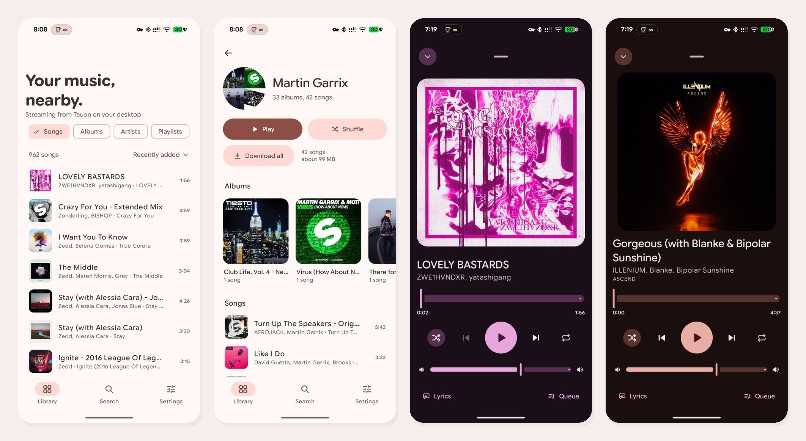

# Muon

**Your Tauon library, on Android.** Stream music from [Tauon Music Box](https://tauonmusicbox.rocks/) over your home network, or save copies for offline listening. Built with Kotlin, Jetpack Compose and Media3.

- Browse songs, albums, artists and playlists, with search.
- Background playback, media controls, lyrics and an editable queue.
- Offline copies on the phone or SD card, plus optional ReplayGain loudness matching.
- Material You colours, dark mode and landscape layouts.

## Install

Get **Muon Stable** from [Releases](https://github.com/averylicious/muon/releases/latest). **Muon β** is the development channel; it installs separately. Both support [Obtainium updates](docs/obtainium.md).

## Connect

1. Enable Tauon's **remote control / server for remote app**, then restart Tauon.
2. Add your music to a Tauon playlist.
3. Connect the phone to the same Wi-Fi and open Muon.

**Trusted home networks only.** Tauon's remote API has no authentication or encryption. Never expose port 7814 to the internet.

Setup help, features and contributor guides are in the [documentation](docs/README.md).

## About

A personal, **vibe-coded hobby project**, made with AI coding assistants and human testing. Provided **as-is, without warranty or guaranteed support**; bugs and security issues may remain. Original code is [MIT licensed](LICENSE).

[Third-party licenses](docs/licenses/README.md) apply to dependencies, fonts and icons. Music, artwork and lyrics belong to their owners. Muon is an independent client, not an official Tauon or Google product.
