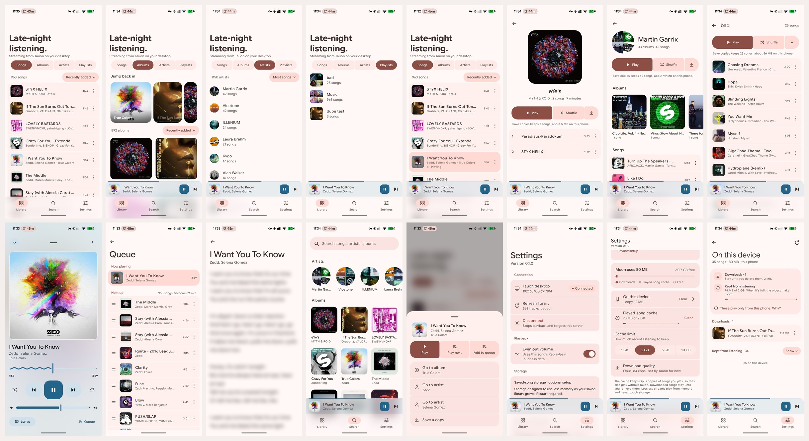
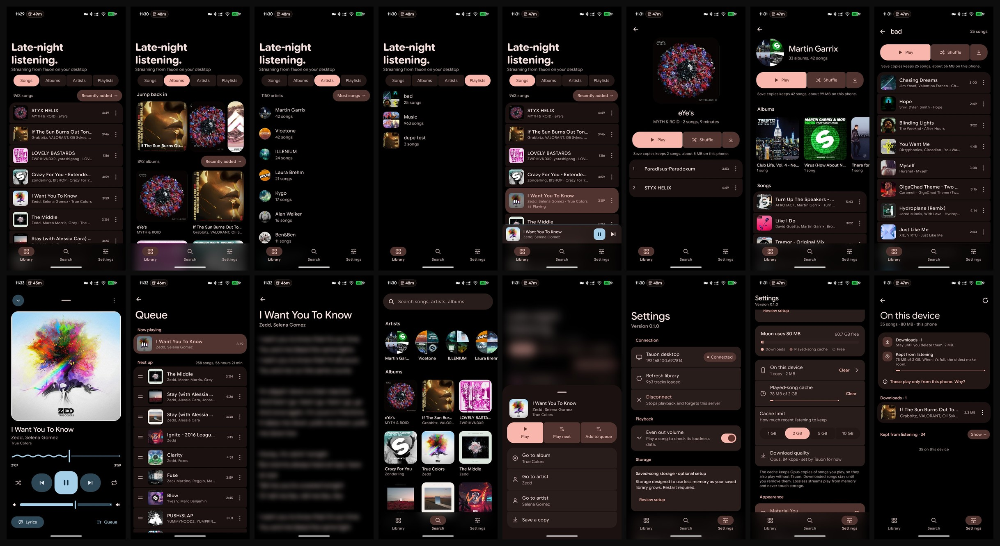

# Muon as it is: reference screens (M3 Expressive RC .1420)

These are real screenshots of **M3 Expressive (Refined)** — frozen RC `.1420` (`dev.avery.muon.release`, `versionCode=1420`) on the user's Pixel 8 (Android 17, 1080 × 2400, 420 dpi), captured on 2026-11-27 against their 963-song Tauon library. Every screen is shown in light and dark (Pure black enabled in dark mode), plus two landscape views. They exist so an agent without phone access can see exactly what the app draws today.

**This folder is the single visual baseline for the current M3 Expressive app.** Outdated drawn mockups (`2.0/`, `landscape/`, `offline/`, `saved-copies-oct23/`) have been removed to avoid confusing agents about the current UI. Where anything here differs from code, trust the Compose source and retake these screenshots after major UI changes.

`hero.jpg`, shown at the top of the project README, pairs four screens from this capture: Light Songs, Light Artist page, Light Now Playing, and Dark Now Playing (with the animated wavy seek bar).

## The screens

| File | Screen | Worth knowing |
| --- | --- | --- |
| `*-01-songs` | Library, Songs (idle) | Collapsing time-of-day greeting, connected segmented library tabs (`Songs \| Albums \| Artists \| Playlists`), song count, tonal sort pill (`Recently added ⌄`), and Expressive joined track cards with `⋮` action buttons. |
| `*-02-albums` | Library, Albums | Horizontal **Jump back in** carousel above the `892 albums` count, tonal sort pill, and two-column cover grid. |
| `*-03-artists` | Library, Artists | Round artist avatars using their newest album cover, count, and `Most songs ⌄` tonal sort pill. |
| `*-04-playlists` | Library, Playlists | Playlists with 2×2 cover mosaics (or single cover for single-album lists) and song counts. |
| `*-05-songs-miniplayer` | Songs, with playback active | Playing row tinted with animated equalizer bars over the cover and `⏸ Playing` label; frosted floating mini player with squircle pause button and artwork-tinted progress strip. |
| `*-06-album` | Album page | Centered hero cover, title, `artist · N songs, M minutes`, connected `Play \| Shuffle \| Save copies` button group, size estimate note, and joined numbered track rows. |
| `*-07-artist` | Artist page | Circular 2×2 artist mosaic, album/song count, connected `Play \| Shuffle \| Save copies` group, horizontal Albums shelf, and joined Songs rows. |
| `*-08-playlist` | Playlist page | Compact top bar with playlist title and count, connected `Play \| Shuffle \| Save copies` group, and joined track rows. |
| `*-09-now-playing` | Now Playing | Artwork-tinted controls, `⋮` song menu in top bar, animated **wavy seek bar** while playing, tonal circular prev/next buttons flanking a squircle play/pause button, media volume slider, tonal `Lyrics` pill, and `Queue` action. |
| `*-10-queue` | Queue | Tinted `Now playing` card with equalizer overlay, then `Next up` as one joined group with left drag handles (when shuffle is off) and per-row `⋮` menus. |
| `*-11-lyrics` | Lyrics | Lyrics text is blurred here only because lyrics are copyrighted; in the app it renders crisp and selectable below the title/artist header. |
| `*-12-search` | Search at rest | Filled pill search bar over circular artist mosaics and a 3-column album grid (plus recent search chips once searches are submitted). |
| `*-13-song-actions` | Song actions sheet (`⋮` / long press) | Blurred backdrop, track header, connected `Play \| Play next \| Add to queue` group, and joined `Go to album`, `Go to artist` (per credited artist), and `Save a copy` rows. |
| `*-14-settings` | Settings (top) | Accent section headings, leading icons on every row, `● Connected` pill, `Refresh library`, `Disconnect`, `Even out volume` switch, and `Saved-song storage` setup card. |
| `*-15-settings-storage` | Settings (Storage & Appearance) | Storage usage summary bar (`Muon uses 80 MB`), `On this device` row with chevron, `Played-song cache` with wavy progress bar, segmented `1 GB \| 2 GB \| 5 GB \| 10 GB` cache limit selector, download quality, and Appearance section. |
| `*-16-on-this-device` | On this device (saved copies) | Large header with summary (`35 songs · 80 MB · this phone`), breakdown card (`Downloads`, `Kept from listening`, wavy meter, info explainer), downloaded track card with file size, and collapsible `Kept from listening` tonal `Show ⌄` pill. |
| `landscape-01-library` | Library, landscape | Left navigation rail, full-height track list, and right-side `PlayerPanel` card with wavy progress bar, squircle pause button, and lyrics/queue icons. |
| `landscape-02-now-playing` | Now Playing, landscape | Two-pane layout: cover on the left, controls, wavy seek bar, volume slider, and top-right lyrics/queue/menu icons on the right. |

Not shown separately: the Connect screen (first run / after Disconnect), offline mode, non-Pure-black dark theme, and SD-card storage rows (hardware-dependent).

## Retaking them

Over ADB, and only with the user's explicit go-ahead for device access in that session. Record and restore all device settings afterwards (`cmd uimode night`, `accelerometer_rotation`, `user_rotation`, and `STREAM_MUSIC` volume). Mute media volume during capture, toggle dark/light with `cmd uimode night yes|no`, and capture landscape with `wm user-rotation lock 1` (restoring `wm user-rotation free`). Save portrait screens at 540 × 1200 JPEG, landscape at 1200 × 540 JPEG, blur copyrighted lyrics, and regenerate `overview-light.jpg`, `overview-dark.jpg`, and `hero.jpg`.
